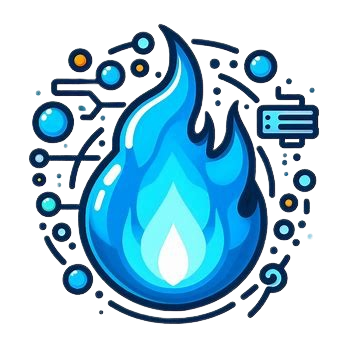

  
  <h1>Flame Framework</h1>

A lightweight MVC PHP framework built for fast application development and clean project structure.

## Features

### Routing & Streaming
- File-based routing
- Defined routing
- Built-in HTTP stream request support

### Authentication
- ✅ Secure basic auth with encrypted passwords and sessions
- 🕒 OAuth support (planned)
- 🕒 JWT support (planned)

### Database
- ✅ MySQL support
- 🕒 MSSQL support (planned)
- 🕒 PostgreSQL support (planned)

### Email Options
- ✅ Native email support
- ✅ SendMail support
- ✅ PhpMailer support
- 🕒 cURL-based email support (planned)

### Console Support
- ✅ WebSocket support
- 🕒 Cron job support (planned)

### Added Support
- ✅ HTMX for inline AJAX requests
- 🕒 React support (planned)
- 🕒 Vue support (planned)
- 🕒 Angular support (planned)
- 🕒 Firebase support (planned)
- ✅ jQuery support

## Roadmap

Planned improvements and integrations for upcoming releases:

- OAuth and JWT authentication
- Additional database drivers (MSSQL, PostgreSQL)
- Cron job task scheduling
- Frontend integration support for React, Vue, Angular, and Firebase
- cURL-based email transport

## About

  
  <i style="padding: 5px; line-height: 200%; display:inline">Written by: Christian Balais</i>

