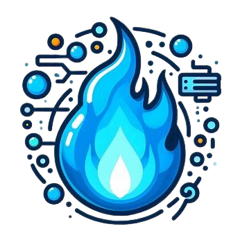

  
  <h1>Flame Framework</h1>

A lightweight MVC PHP framework built for fast application development and clean project structure.

## Features

### Routing & Streaming
- File-based routing
- Defined routing
- Built-in HTTP stream request support

### Authentication
- ✅ Secure basic auth with encrypted passwords and sessions
- ✅ OAuth 2.0 server helpers and schema installer
- ✅ HS256 JWT signing and verification

### Database
- ✅ PDO MySQL, MSSQL/SQL Server, and PostgreSQL support

### Email Options
- ✅ Native email support
- ✅ SendMail support
- ✅ PhpMailer support
- ✅ Generic JSON HTTP email transport using cURL

### Console Support
- ✅ WebSocket support
- ✅ Cron-expression scheduler with task locks

### Added Support
- ✅ HTMX for inline AJAX requests
- ✅ React and Vue API-client examples
- ✅ Angular API-client example
- ✅ Firebase client integration guidance
- ✅ jQuery support

## Configuration

Install PHP dependencies with `composer install --working-dir=app`. Copy `.env.example` as a reference and provide the variables through your process manager or deployment platform. Flame does not automatically load `.env` files. Never commit actual credentials. PHP must have the PDO extension for the configured driver; cURL email also requires PHP's cURL extension.

See [database, authentication, scheduler, mail, and frontend integration guides](./docs/integrations.md) for setup and usage details.

## About

  
  <i style="padding: 5px; line-height: 200%; display:inline">Written by: Christian Balais</i>

